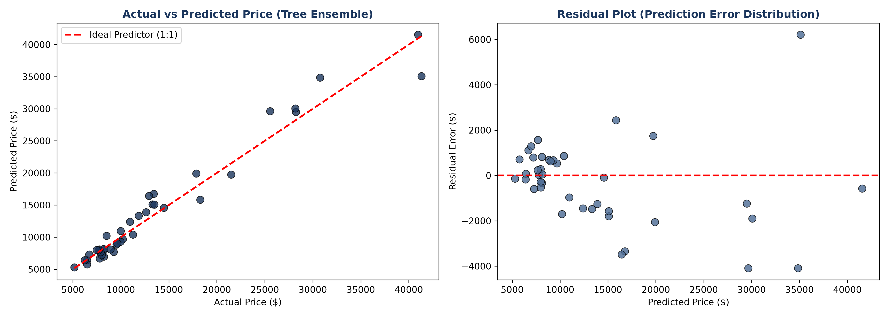
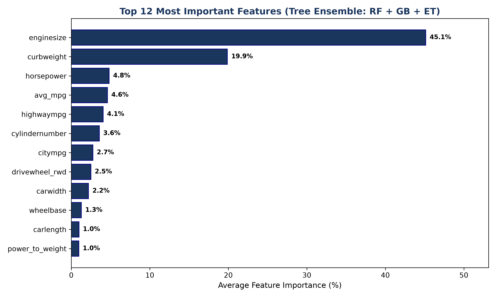
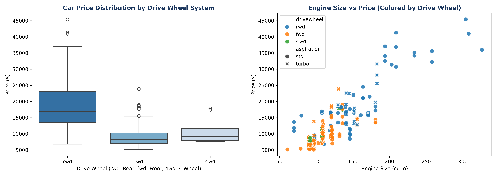

# Combustion Engine Car Price Prediction

**A Heterogeneous Tree-Based Voting Ensemble with Feature Importance Analysis**

This project predicts car prices from technical specifications. It compares a linear baseline, three tree-based ensembles, a PyTorch neural network, and a Voting Regressor that averages Random Forest, Gradient Boosting and Extra Trees.

It was built for a Data Science course project at Bina Nusantara ASO School of Engineering. The methodology is written up in an IEEE-format course report, which is not included in this repository.

## Dataset

[Car Price Prediction dataset](https://www.kaggle.com/datasets/hellbuoy/car-price-prediction) from Kaggle (M. Kumar). The file is `CarPrice_Assignment.csv`.

- 205 vehicles, 26 attributes, with `price` as the regression target
- Prices range from $5,118 to $45,400 (mean $13,276.71, median $10,295)
- Numerical features: engine size, horsepower, curb weight, dimensions and fuel economy
- Categorical features: fuel type, aspiration, body style, drivetrain and engine location

## Method

**Preprocessing**
1. Extract the brand from `CarName` and fix typos (`maxda` → `mazda`, `vokswagen`/`vw` → `volkswagen`, `porcshz` → `porsche`, `toyouta` → `toyota`).
2. Convert door and cylinder counts from words to integers.
3. Add engineered features: `avg_mpg`, the mean of city and highway MPG, and `power_to_weight`, which is horsepower divided by curb weight.
4. Split the data 80/20 into 164 training and 41 test rows, with `random_state=42`.
5. Standardise numerical features and one-hot encode categorical ones. Both are fitted on the training set only, to avoid leakage.

**Models**

| Model | Configuration |
|---|---|
| Ridge Regression | α = 1.0 (linear baseline) |
| Random Forest | 100 estimators |
| Gradient Boosting | 100 estimators |
| Extra Trees | 100 estimators |
| ANN (PyTorch) | 128 → 64 → 32 → 1 MLP with ReLU, BatchNorm and Dropout 0.2. Adam (lr 0.01, weight decay 1e-4), 300 epochs, standardised target |
| **Tree Ensemble** | `VotingRegressor` that averages RF + GB + ET |

## Results

Test set, n = 41:

| Model | MAE ($) | RMSE ($) | MAPE (%) | RMSPE (%) | R² |
|---|---:|---:|---:|---:|---:|
| Ridge Regression | 2029.33 | 2894.18 | 17.70 | 26.35 | 0.8939 |
| Random Forest | 1293.19 | **1817.27** | 9.43 | 11.48 | **0.9582** |
| Gradient Boosting | 1582.48 | 2237.39 | 10.75 | 12.92 | 0.9366 |
| Extra Trees | 1361.61 | 2064.08 | 9.79 | 11.86 | 0.9460 |
| ANN | **1217.63** | 2048.41 | **9.28** | 11.54 | 0.9468 |
| Tree Ensemble (RF+GB+ET) | 1314.26 | 1847.94 | 9.29 | **11.22** | 0.9567 |

- Random Forest has the best R² and RMSE, and the ANN has the lowest MAE.
- The Tree Ensemble has the lowest RMSPE. Its MAPE (9.29%) is effectively tied with the ANN's (9.28%).
- All non-linear models clearly outperform the Ridge baseline.

### Actual vs predicted (Tree Ensemble)


The residuals range from about −$4,092 to $6,210. They spread out at higher predicted prices, so the largest errors come from a few expensive cars.

### Feature importance


Engine size (45.1%) and curb weight (19.9%) dominate, followed by horsepower (4.8%), average MPG (4.6%) and highway MPG (4.1%).

### Exploratory plots


## How to run

Tested with Python 3.12.

```bash
git clone <this-repo-url>
cd car-price-prediction
python -m venv .venv
# Windows: .venv\Scripts\activate    macOS/Linux: source .venv/bin/activate
pip install -r requirements.txt   # for a smaller CPU-only PyTorch, add: --extra-index-url https://download.pytorch.org/whl/cpu
pip install notebook
jupyter notebook car_price_prediction.ipynb
```

Run all cells. The notebook reads `CarPrice_Assignment.csv` from the same folder and regenerates the three figures.

## Repository structure

```
car-price-prediction/
├── car_price_prediction.ipynb   # full pipeline: preprocessing, models, evaluation, figures
├── CarPrice_Assignment.csv      # dataset (Kaggle)
├── actual_vs_predicted.png      # Tree Ensemble predictions and residuals
├── feature_importance.png       # top-12 averaged tree importances
├── eda_features.png             # drive wheel and engine size vs price
├── requirements.txt
└── README.md
```

## Authors

- TODO: Name
- TODO: Name
- TODO: Name
- TODO: Name

Bina Nusantara ASO School of Engineering, Jakarta, Indonesia
